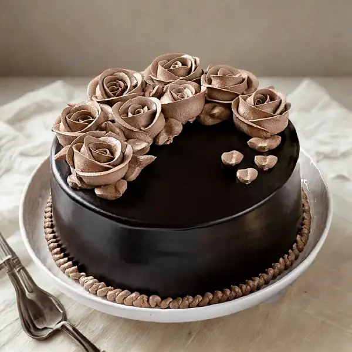
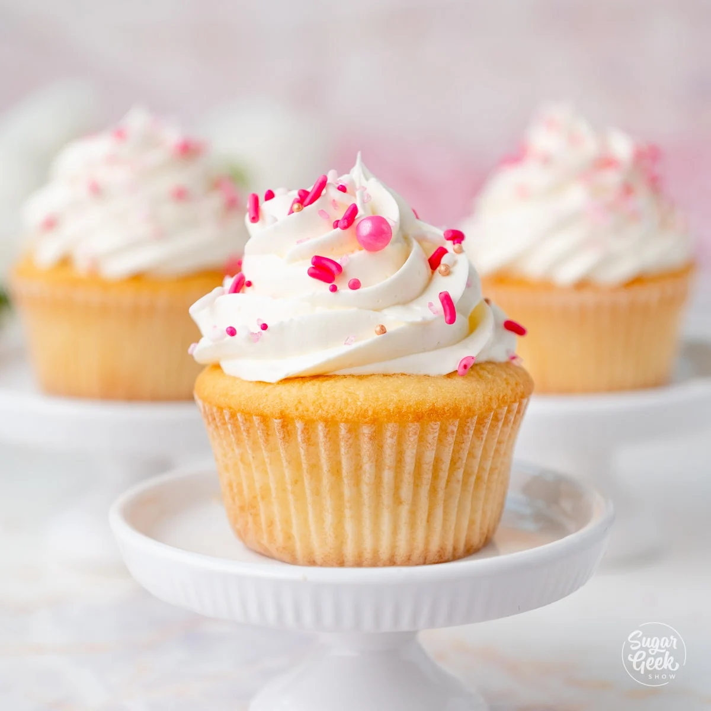
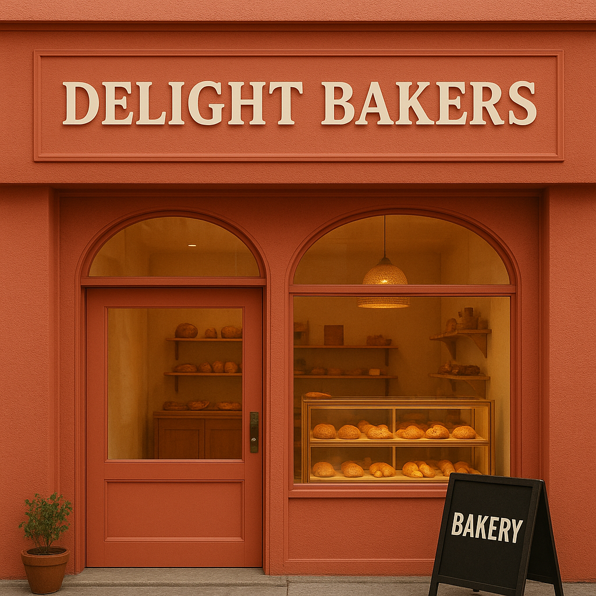

# Ex02 Commercial Website
## Date:

## AIM
To create a commercial website using CSS Flexbox.

## ALGORITHM
### STEP 1
Create an HTML file (index.html)

### STEP 2
Create a CSS file (style.css)

### STEP 3
Include a navigation bar with links to different sections.

### STEP 4
Add structured sections for Homepage, Products / Services, About Us, Contact Details and User Account.

### STEP 5
Include social media links at the footer with copyright information.

### STEP 6
Define global styles for fonts, colors, and layout.

### STEP 7
Style the header, navigation bar, and sections.

### STEP 8
Use Flexbox for layout design.

### STEP 9
Add hover effects and transitions for interactivity.

### STEP 10
Add Images and Media.

### STEP 11
Use optimized images for a professional look.

### STEP 12
Open the HTML file in a browser to check layout and functionality.

### STEP 13
Fix styling issues and refine content placement.

### STEP 14
Deploy the website.

### STEP 15
Upload to GitHub Pages for free hosting.

## PROGRAM
```html
<!DOCTYPE html>
<html lang="en">
<head>
    <meta charset="UTF-8">
    <meta name="viewport" content="width=device-width, initial-scale=1.0">
    <title>Delight Bakers</title>
    <link rel="stylesheet" href="style.css">
</head>
<body>
    <!-- Navigation -->
    <header>
        <nav>
            <div class="logo">Delight <span>Bakers</span></div>
            <div class="navbar1">
                <a href="#home" class="active">Home</a>
                <a href="#menu">Menu</a>
                <a href="#about">About</a>
                <a href="#contact">Contact</a>
            </div>
        </nav>
    </header>

    <!-- Hero Section -->
    <section id="home" class="main">
        <video autoplay loop muted plays-inline class="video">
            <source src="assets/bakery.mp4" type="video/mp4" />
        </video>
        <div class="content">
            <h1>D<span>elight</span> B<span>akers</span></h1>
            <p>From our oven to your heart — every bite tells a story.</p>
            <div class="promo">Fresh bakes starting at just <strong>₹99</strong></div>
            <a href="#menu" class="btn">Shop Now</a>
        </div>
    </section>

    <!-- Menu Section -->
    <section id="menu" class="menu">
        <h2>Our <span>Menu</span></h2>
        <div class="menu-container">
            <div class="menu-card">
                
                <h3>Chocolate Cake</h3>
                <p>Rich, moist and made with love.</p>
                <p class="price">₹499</p>
            </div>
            <div class="menu-card">
                
                <h3>Vanilla Cupcake</h3>
                <p>Light, creamy, and full of flavor.</p>
                <p class="price">₹99</p>
            </div>
            <div class="menu-card">
                
                <h3>Strawberry Pastry</h3>
                <p>Fresh cream layered with soft sponge.</p>
                <p class="price">₹149</p>
            </div>
        </div>
    </section>

    <!-- About Section -->
    <section id="about" class="about">
        <h2>About <span>Us</span></h2>
        <div class="about-content">
            
            <div class="text">
                <p>
                    Welcome to <strong>Delight Bakers</strong>, where passion meets perfection. 
                    We bake with the finest ingredients and craft every product with care and love.
                    From traditional cakes to modern desserts, we make every occasion special.
                </p>
                <p>
                    Our mission is simple — to bring happiness in every bite. Visit us once, and you'll 
                    taste the difference that comes from true craftsmanship.
                </p>
            </div>
        </div>
    </section>

    <!-- Contact Section -->
    <section id="contact" class="contact">
        <h2>Contact <span>Us</span></h2>
        <div class="contact-container">
            <form class="contact-form">
                <input type="text" placeholder="Your Name" required>
                <input type="email" placeholder="Your Email" required>
                <textarea rows="5" placeholder="Your Message" required></textarea>
                <button type="submit">Send Message</button>
            </form>
        </div>
    </section>

    <!-- Footer -->
    <footer>
        <p>© 2025 Delight Bakers | Made with ❤️ by Ahamed Sahul</p>
    </footer>
</body>
</html>
```

``` css
@import url('https://fonts.googleapis.com/css2?family=Alkatra:wght@400..700&family=Poppins:wght@400;500&display=swap');

* {
    margin: 0;
    padding: 0;
    box-sizing: border-box;
}
html {
    scroll-behavior: smooth;
}
body {
    font-family: "Poppins", sans-serif;
    background: #fff;
    color: #000;
    overflow-x: hidden;
}
header {
    position: fixed;
    top: 0;
    width: 100%;
    z-index: 10;
}
nav 
{
    display: flex;
    justify-content: space-between;
    align-items: center;
    padding: 15px 80px;
    background: rgba(255, 255, 255, 0.3);
    backdrop-filter: blur(10px);
}
.logo {
    font-family: "Alkatra";
    font-size: 1.8rem;
    color: #000;
}
.logo span {
    color: #eab308;
}
.navbar1 a {
    margin: 0 15px;
    text-decoration: none;
    color: #000;
    font-weight: 500;
    transition: 0.3s;
}
.navbar1 a:hover {
    color: #eab308;
}
.main {
    position: relative;
    height: 100vh;
    display: flex;
    justify-content: center;
    align-items: center;
    text-align: center;
}
.video {
    position: absolute;
    width: 100%;
    height: 100%;
    object-fit: cover;
    filter: blur(4px) brightness(70%);
    z-index: -1;
}
.content h1 {
    font-family: "Alkatra";
    font-size: 3.5rem;
    color: #fff;
    letter-spacing: 2px;
    margin-bottom: 15px;
}
.content h1 span {
    color: #facc15;
}
.content p {
    color: #fff;
    margin-bottom: 10px;
}
.promo {
    color: #fff;
    font-weight: 600;
    margin-bottom: 20px;
}
.btn {
    display: inline-block;
    padding: 12px 30px;
    background: #facc15;
    color: #000;
    border-radius: 30px;
    font-weight: bold;
    text-decoration: none;
    transition: 0.3s;
}
.btn:hover {
    background: #fbbf24;
}
.menu {
    padding: 80px 50px;
    text-align: center;
}
.menu h2 {
    font-family: "Alkatra";
    font-size: 2.5rem;
    margin-bottom: 40px;
}
.menu h2 span {
    color: #eab308;
}
.menu-container {
    display: flex;
    justify-content: center;
    gap: 40px;
    flex-wrap: wrap;
}
.menu-card {
    background: #fff;
    border-radius: 15px;
    box-shadow: 0 2px 10px rgba(0,0,0,0.1);
    width: 280px;
    padding: 20px;
    transition: 0.3s;
}
.menu-card:hover {
    transform: translateY(-5px);
}
.menu-card img {
    width: 100%;
    border-radius: 10px;
    height: 180px;
    object-fit: cover;
}
.price {
    color: #eab308;
    font-weight: bold;
    margin-top: 10px;
}
.about {
    padding: 80px 60px;
    background: #fef3c7;
}
.about h2 {
    text-align: center;
    font-family: "Alkatra";
    font-size: 2.5rem;
    margin-bottom: 40px;
}
.about h2 span {
    color: #eab308;
}
.about-content {
    display: flex;
    align-items: center;
    justify-content: center;
    gap: 40px;
    flex-wrap: wrap;
}
.about-content img {
    width: 400px;
    border-radius: 15px;
    object-fit: cover;
}
.about-content .text {
    max-width: 500px;
    line-height: 1.7;
    font-size: 1rem;
}
.contact {
    padding: 80px 50px;
    text-align: center;
}
.contact h2 {
    font-family: "Alkatra";
    font-size: 2.5rem;
    margin-bottom: 40px;
}
.contact h2 span {
    color: #eab308;
}
.contact-form {
    max-width: 500px;
    margin: auto;
    display: flex;
    flex-direction: column;
    gap: 15px;
}
.contact-form input,
.contact-form textarea {
    padding: 12px;
    border-radius: 10px;
    border: 1px solid #ccc;
    font-size: 1rem;
}
.contact-form button {
    padding: 12px;
    border: none;
    border-radius: 25px;
    background: #facc15;
    font-weight: bold;
    cursor: pointer;
    transition: 0.3s;
}
.contact-form button:hover {
    background: #fbbf24;
}
footer {
    background: #000;
    color: #fff;
    text-align: center;
    padding: 15px;
    font-size: 0.9rem;
}

@media (min-aspect-ratio: 16/9) 
{
    .video 
    {
        width: 100%;
        height: auto;
    }
}
```


## OUTPUT


## RESULT
The program for creating commercial website using CSS Flexbox is executed successfully.
